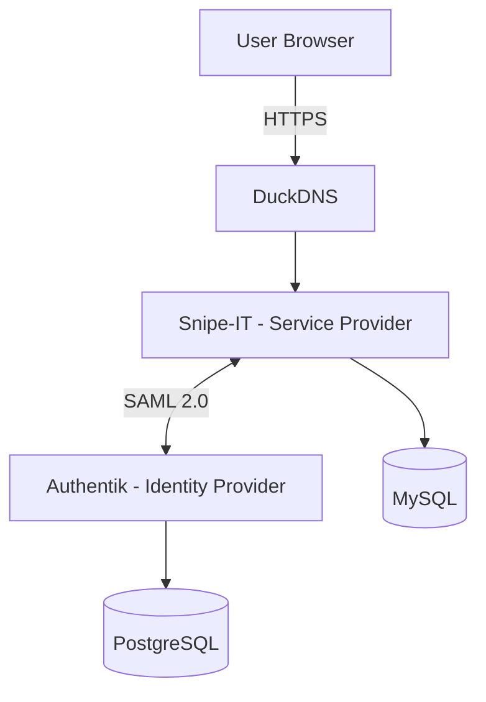

# AWS Terraform Snipe-IT Lab

A hands-on cloud infrastructure project deploying **Snipe-IT Asset Management** and **Authentik Identity Provider** on AWS using Terraform, Docker, HTTPS, and SAML 2.0 Single Sign-On.

## Project Overview

This project demonstrates practical experience with:

- Infrastructure as Code (IaC) using Terraform
- AWS EC2, VPC networking, and security groups
- Docker and Docker Compose
- Linux server administration
- HTTPS reverse proxy using Caddy
- Identity and Access Management (IAM)
- SAML 2.0 Single Sign-On using Authentik
- AWS Systems Manager for remote administration and secret storage

## Architecture



Both applications run on separate AWS EC2 instances within the same VPC.

Caddy provides HTTPS termination and reverse proxy functionality for each application.

## Technology Stack

| Component | Technology |
|---|---|
| Cloud Provider | Amazon Web Services |
| Infrastructure as Code | Terraform |
| Compute | Amazon EC2 |
| Containers | Docker / Docker Compose |
| Asset Management | Snipe-IT |
| Identity Provider | Authentik |
| Single Sign-On | SAML 2.0 |
| Web Proxy / HTTPS | Caddy |
| Snipe-IT Database | MySQL 8 |
| Authentik Database | PostgreSQL |
| Remote Administration | AWS Systems Manager |
| DNS | DuckDNS |
| Version Control | Git / GitHub |

## Authentication Flow

1. A user opens Snipe-IT.
2. Snipe-IT redirects the user to Authentik.
3. Authentik authenticates the user.
4. Authentik generates a SAML assertion containing the user's identity.
5. Snipe-IT validates the assertion and matches the existing user account.
6. The user accesses the Snipe-IT dashboard.

The SAML NameID is mapped to the Authentik username.

## Security Configuration

- HTTPS enabled for both public applications
- AWS security groups restrict inbound application traffic to HTTP/HTTPS
- Internal application ports are not directly exposed through AWS security groups
- SAML authentication integrated with Authentik
- AWS Systems Manager used for remote instance access
- Sensitive Terraform state files excluded from version control
- Application credentials kept outside the Git repository
- Local Snipe-IT administrator login retained for emergency access

**Note:** This is a learning and portfolio environment, not a production-hardened deployment.

## Repository Structure

```text
aws-terraform-snipeit-lab/
├── main.tf
├── authentik.tf
├── https-security.tf
├── install-docker.sh
├── deploy-snipeit.sh
├── .gitignore
└── README.md
```

## Project Outcomes

Successfully deployed two containerized applications on AWS, configured HTTPS access, integrated SAML 2.0 SSO, and verified authentication into Snipe-IT through Authentik.

## Future Improvements

- Terraform remote state with encryption and locking
- Automated DNS updates or static public IP addressing
- Automated backups and recovery testing
- Centralized monitoring and logging
- More restrictive network access and security hardening
- Automated deployment pipeline using GitHub Actions

## Disclaimer

This repository is intended for educational purposes. Credentials, secrets, Terraform state files, and private keys must never be committed to GitHub.
